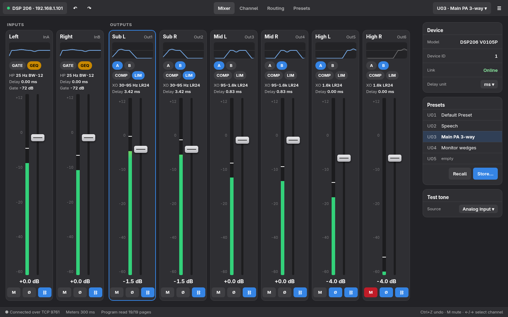

# meredsp206

A native Linux editor for the **t.racks DSP 206** loudspeaker processor (2 in /
6 out), controlled over the local network. It aims to cover every feature of the
Windows-only *the t.racks DSP 206 Processor Editor V1.05*, with a cleaner,
faster interface.

> **Project status: early.** The device protocol has been reverse engineered and
> documented ([claude/docs/protocol.md](claude/docs/protocol.md)). The protocol
> library (`crates/dsp206-proto`) is implemented and tested. The application
> itself is **not written yet**. The sections below marked *(planned)* describe
> the target.

## Features (planned)

- Find DSP 206 units on the LAN automatically, or connect by IP.
- Mixer view: all 8 channels at a glance with level meters, gain, mute, polarity
  and names.
- Per input: gain, mute, polarity, delay, noise gate, 31-band graphic EQ,
  8-band parametric EQ, high-pass and low-pass filters.
- Per output: input routing matrix with mix levels, gain, mute, polarity, delay,
  9-band parametric EQ, high-pass/low-pass (Butterworth, Bessel, Linkwitz-Riley up
  to 48 dB/oct), RMS compressor and peak limiter.
- Channel linking and copying, channel names.
- Presets on the device: list, recall, store with a name. Save and load programs
  as files.
- Test tone generator (pink noise, white noise, sine), device lock.
- Offline mode to prepare a program without the device.

The target look is in [`design/`](design/):



## Requirements

- Debian 13 (trixie) or newer, or another recent Linux distribution with GTK 4.
- A t.racks DSP 206 reachable on your network. Factory IP: `192.168.1.101`, TCP
  port `9761`.

## Build from source (planned)

Install the build dependencies:

```bash
sudo apt install build-essential pkg-config libgtk-4-dev libadwaita-1-dev cargo rustc
```

Build:

```bash
cargo build --release
```

The binaries are written to `target/release/`: `meredsp206` (GUI) and `dsp206`
(command-line tool).

## Install (planned)

```bash
sudo make install PREFIX=/usr/local
```

This installs both binaries, a desktop entry and an icon. Remove them with
`sudo make uninstall PREFIX=/usr/local`.

## Usage (planned)

1. Connect the DSP 206 to the same network as your computer.
2. Start **meredsp206** from your application menu. The unit appears in the device
   list. Otherwise enter its IP address.
3. The current program is read from the device. Every change you make is sent
   immediately.

Good to know: the DSP accepts only one network connection at a time. Close the
Windows editor or any other client first. After a disconnection, wait about one
minute before reconnecting.

## Development

Requirements: Rust 1.84 or newer (`cargo`, `rustfmt`, `clippy`), Python 3, `make`.

```bash
make check
```

This runs the formatter check, clippy with warnings as errors, the Rust tests
(including replays of frames captured on a real DSP 206) and the Python tests
for the tools and the documentation. Other targets: `make test`, `make lint`,
`make fmt`, `make design`.

## Documentation

- [Product overview and feature inventory](claude/docs/overview.md)
- [Network protocol](claude/docs/protocol.md)
- [Program memory map and value encodings](claude/docs/memory-map.md)
- [Connection behaviour](claude/docs/connection.md)
- [Planned architecture](claude/docs/architecture.md)

## Legal

This project is not affiliated with Thomann or the manufacturer of the DSP 206.
The protocol was studied for interoperability. No vendor code or assets are
included in this repository.
